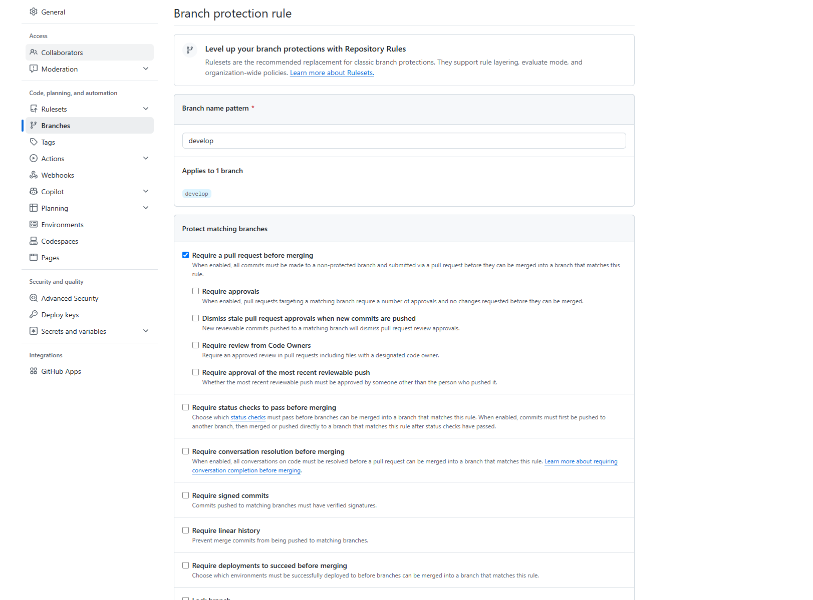
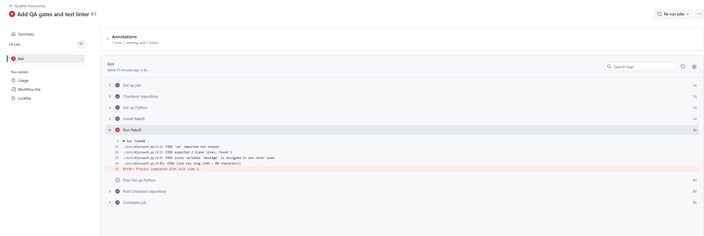
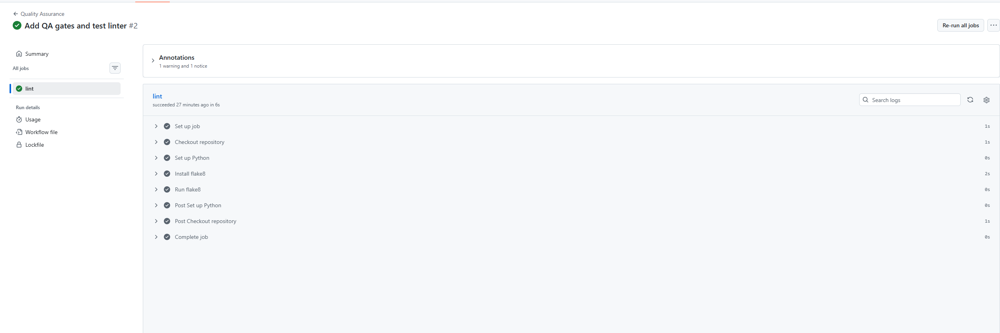

Лабораторная работа №1

Комплексный анализ, настройка инфраструктуры и контроль качества ПО

Проект: микросервис расчёта скидок интернет-магазина
Репозиторий: lab1-comprehensive-Voroncov

⸻

1. Executive Summary

В ходе лабораторной работы выполнены анализ требований к микросервису расчёта скидок, выбор системы управления базами данных, настройка инфраструктуры разработки и организация автоматического контроля качества программного кода.

Созданы рабочие ветки Git, настроены правила совместной разработки, добавлены конфигурационные файлы и GitHub Actions для автоматической проверки Python-кода с помощью Flake8.

Также разработаны UML-диаграмма алгоритма расчёта скидок и план проверки кода.

2. Выбор системы управления базами данных

2.1. Сравнение PostgreSQL и MongoDB

Для микросервиса расчёта скидок рассмотрены две системы управления базами данных: PostgreSQL и MongoDB.

Для оценки использованы пять критериев с весовыми коэффициентами.

Критерий Вес PostgreSQL MongoDB
Надёжность транзакций 0.30 5 4
Производительность 0.20 4 5
Гибкость структуры данных 0.15 3 5
Масштабируемость 0.15 4 5
Удобство сопровождения 0.20 5 4
Итого 1.00 4.35 4.50

Расчёт PostgreSQL:

0.30 × 5 + 0.20 × 4 + 0.15 × 3 + 0.15 × 4 + 0.20 × 5 = 4.35.

Расчёт MongoDB:

0.30 × 4 + 0.20 × 5 + 0.15 × 5 + 0.15 × 5 + 0.20 × 4 = 4.50.

2.2. Обоснование выбора

Несмотря на более высокий суммарный балл MongoDB, для микросервиса расчёта скидок выбрана PostgreSQL.

Основной причиной является важность целостности финансовых данных, надёжности транзакций и согласованности результатов расчёта.

PostgreSQL обеспечивает поддержку ACID-транзакций и подходит для хранения заказов, скидок, промокодов и информации о клиентах.

3. Настройка инфраструктуры разработки

3.1. Структура репозитория

Для проекта создан публичный GitHub-репозиторий.

Используются следующие ветки:

* main — основная ветка проекта.
* develop — ветка разработки.
* feature/infrastructure — настройка инфраструктуры.
* feature/qa-gates — автоматические проверки качества.
* feature/review-plan — план Code Review и UML-диаграмма.

3.2. Настройка Branch Protection

Для ветки develop настроены правила защиты.

Изменения должны проходить через Pull Request. Это позволяет контролировать изменения и уменьшает риск попадания ошибок в основную ветку разработки.

Скриншот настроек Branch Protection:

3.3. CODEOWNERS и EditorConfig

В репозиторий добавлен файл .editorconfig, который задаёт единые правила форматирования файлов проекта.

Файл .github/CODEOWNERS определяет ответственных за проверку изменений.

Такая настройка помогает поддерживать единый стиль кода и организовать процесс Code Review.

4. Автоматический контроль качества

4.1. GitHub Actions и Flake8

В проект добавлен файл .flake8, задающий ограничения для проверки Python-кода.

В .github/workflows/qa.yml настроен GitHub Actions workflow, который запускает Flake8 при создании или обновлении Pull Request в ветку develop.

4.2. Проверка с ошибками и после исправления

Для проверки работы CI первоначально использовался Python-код с нарушениями требований Flake8.

Автоматическая проверка обнаружила ошибки и завершилась неуспешно.

После исправления файла src/discount.py проверка была запущена повторно и завершилась успешно.

Скриншот неуспешной проверки:

Скриншот успешной проверки:

4.3. Результат

Использование GitHub Actions позволяет автоматически выявлять нарушения стандартов оформления Python-кода до объединения изменений.

5. Анализ алгоритма расчёта скидок

5.1. UML-диаграмма

Для анализа бизнес-логики разработана диаграмма активности, отображающая процесс расчёта итоговой стоимости заказа.

Алгоритм включает:

1. Получение первоначальной суммы корзины.
2. Применение скидки 15% при сумме заказа более 15 000 рублей.
3. Обработку промокодов SUMMER и VIP.
4. Применение скидки в зависимости от уровня клиента.
5. Проверку ограничения максимальной скидки.
6. Возврат итоговой стоимости

заказа.

UML-диаграмма:

5.2. Потенциальные Code Smells

При анализе алгоритма выделены следующие потенциальные проблемы:

1. Сложная логика условий. Большое количество вложенных проверок затрудняет чтение и сопровождение кода.

2. Магические числа. Значения скидок и пороговых сумм непосредственно используются в алгоритме.

3. Повторение логики. Обработка различных промокодов может приводить к дублированию кода.

4. Недостаточное разделение ответственности. Расчёт скидок, обработка промокодов и ограничение итоговой скидки желательно разделить на отдельные функции.

5.3. Предложения по улучшению

Рекомендуется:

* Вынести значения скидок в именованные константы.
* Разделить расчёт скидок на небольшие функции.
* Добавить автоматические тесты для разных сценариев.
* Проверять корректность входных данных.
* Отдельно тестировать максимальный размер скидки.

6. План проверки кода

Для проекта подготовлен документ Code Review Plan, содержащий цели проверки, критерии качества, роли участников, метрики и порядок эскалации проблем.

План проверки кода:

Открыть review-plan.md

Документ находится в ветке feature/review-plan.

Соответствующий Pull Request №3 оставлен открытым для проверки.

7. Результаты лабораторной работы

В результате выполнения работы:

1. Проведено сравнение PostgreSQL и MongoDB.
2. Выбрана СУБД для микросервиса.
3. Создан GitHub-репозиторий с рабочими ветками.
4. Добавлены .editorconfig и CODEOWNERS.
5. Настроены правила защиты ветки develop.
6. Добавлена автоматическая проверка Flake8.
7. Получены результаты неуспешной и успешной проверок.
8. Разработана UML-диаграмма.
9. Подготовлен план Code Review.
10. Создан Pull Request с планом проверки и диаграммой.

8. Заключение

В ходе лабораторной работы получены практические навыки анализа требований, выбора системы управления базами данных, работы с Git и GitHub, настройки GitHub Actions и организации контроля качества программного обеспечения.

Автоматизация проверок и использование Code Review повышают надёжность разработки и позволяют обнаруживать ошибки на ранних этапах.
